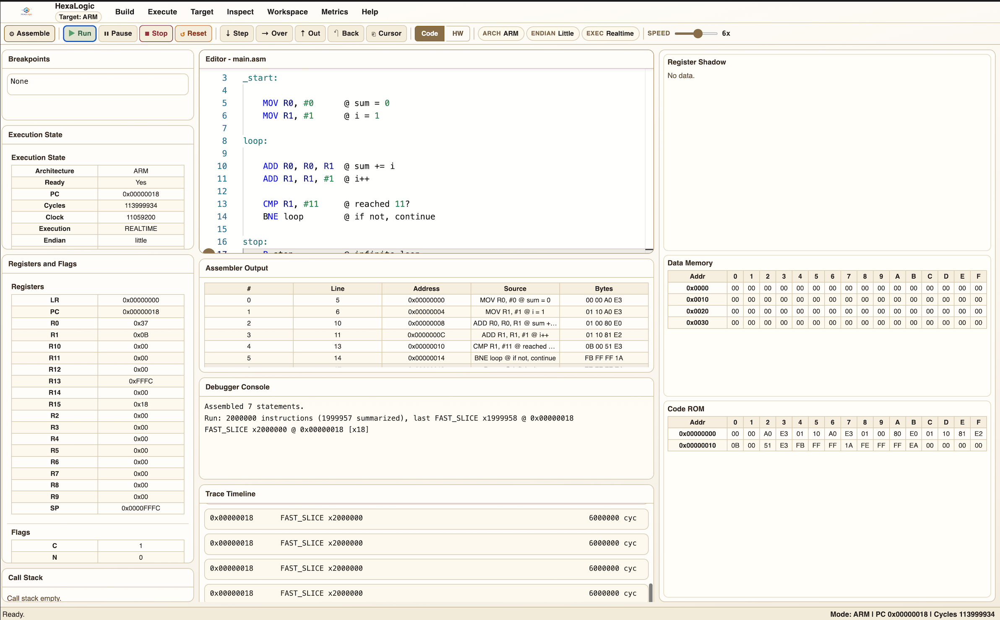

# HexaLogic

<p align="center">
  
</p>

<p align="center">
  
  
  
  
</p>

A browser-based, multi-architecture microcontroller simulation platform centered on a high-fidelity AT89C51/8051 core, with a functional/minimal ARM core, deterministic time-travel debugging, virtual hardware fault injection, an automated UART protocol analyzer, and a multi-node virtual UART network. Runs entirely against a Python/Flask backend — no local installation, license, or OS-specific tooling required.

**Live deployment:** [www.hexalogic.xyz](https://www.hexalogic.xyz)

---

## Statement of need

Existing 8051 simulation tools force a tradeoff between accessibility and capability: Keil µVision is cycle-accurate but requires a Windows install and a commercial license; Proteus VSM adds circuit-level co-simulation at the same desktop-bound, proprietary cost; EdSim51 is browser-based but ships as a Java applet most modern browsers no longer run without extra configuration, and has no reverse-debugging; MCU 8051 IDE is open source but desktop-only with limited peripheral modeling. None of them combines zero-installation browser access with backward-stepping debugging, hardware fault injection, or automated protocol analysis. HexaLogic targets students, instructors, and self-learners who need a free, cross-platform 8051/ARM lab environment reachable from any device with a browser, and educators who want to demonstrate hardware fault conditions or serial-protocol debugging without physical lab equipment. See [`paper/paper.md`](paper/paper.md) for the full statement of need and comparison, and the companion methodology paper in `docs/` for the underlying simulation model and validation methodology.

---

## Screenshots

<p align="center">
  
  <br><em>HexaLogic — live at <a href="https://www.hexalogic.xyz">www.hexalogic.xyz</a></em>
</p>

---

## Features

- Assembly compilation, step-by-step execution, PC-driven fetch/decode/execute simulation
- Internal RAM, Code ROM, and XRAM views; register + SFR inspection; memory editing
- Breakpoints, watchpoints, trace timeline, and call-stack view
- **Reverse-step / time-travel debugging** via reverse-delta state capture
- **Virtual hardware fault injection** (stuck-high, stuck-low, delay, noise) on simulated pins
- **Automated UART protocol analyzer** — infers baud rate, serial mode, and frame format from live SFR state
- **Multi-node virtual UART network** — bridges independently running sessions via TX→RX links
- Functional/minimal ARM execution path with endian switching (not cycle-accurate)
- Session export/import, Redis-ready isolated multi-user session storage
- Plugin-ready architecture registry (`register_plugin()`) for adding new target architectures

---

## Architecture

```text
Monaco / Incremental Debug UI
            |
            | REST API (JSON)
            v
SessionStore (memory / Redis)
            |
            v
CPU / Assembler Factory
      |               |
      v               v
    8051             ARM
            |
            v
Virtual Memory + Debugger + Peripherals
```

See [`paper/paper.md`](paper/paper.md) and `docs/figures/system_architecture.png` for the full architecture diagram and description.

### Project Structure

```text
HEXALOGIC/
├── api/                    # Flask entry point, REST API blueprint, templates, static assets
├── core/                   # Legacy 8051 engine (originated from an earlier open-source
│                           #   8051 simulator by Devansh Shukla, 2022 — see Acknowledgements)
├── sim8051/                # Multi-architecture emulator runtime (8051 + ARM), debugger,
│                           #   virtual hardware, fault injection, protocol analyzer, UART network
├── tests/                  # Pytest test suite (154 tests)
├── test_new_features.py    # Standalone end-to-end verification suite (54 tests)
├── scripts/regression_audit.py  # Regression audit (10 checks)
├── validation/             # Independent cross-tool timing validation infrastructure
├── docs/                   # Companion IEEE-style methodology paper and design notes
├── paper/                  # JOSS paper (this submission)
├── screenshots/            # UI screenshots
├── Dockerfile, wsgi.py, gunicorn.conf.py, Procfile, render.yaml, netlify.toml, vercel.json
└── requirements.txt / pyproject.toml
```

---

## Installation & Local Development

```bash
git clone https://github.com/AshwinderPalSingh/HEXALOGIC-ONLINE-EMULATOR.git
cd HEXALOGIC-ONLINE-EMULATOR
python3 -m venv .venv
source .venv/bin/activate
pip install -e .
```

Run locally (Flask CLI):

```bash
flask --app api/index.py run --debug
```

or via the WSGI entry point:

```bash
python wsgi.py
```

Then open <http://127.0.0.1:8080>.

---

## Testing

HexaLogic's validation suite totals 218 automated checks across three layers:

```bash
# Core pytest suite (154 tests)
python3 -m pytest tests/ -v

# Standalone end-to-end feature suite (54 tests)
python3 test_new_features.py

# Regression audit (10 checks)
python3 scripts/regression_audit.py
```

Independent cross-tool timing validation (against Keil µVision 5 on physical AT89C51 hardware) is documented in `validation/independent_check/` and in the companion paper (`docs/`).

---

## Community Guidelines

- **Contributing**: see [CONTRIBUTING.md](CONTRIBUTING.md) for development setup, coding conventions, and the PR process.
- **Reporting bugs / requesting features**: use the issue templates in [`.github/ISSUE_TEMPLATE/`](.github/ISSUE_TEMPLATE/).
- **Support**: open a GitHub issue, or contact the maintainer at asingh47_be23@gmail.com.

---

## Citation

If you use HexaLogic in academic work, please cite it using [CITATION.cff](CITATION.cff), or see [`paper/paper.md`](paper/paper.md) for the JOSS paper and `docs/` for the companion methodology paper.

---

## Acknowledgements

HexaLogic's `core/` execution engine and initial project scaffold (Flask API layout, deployment configuration) began as a fork of [Devansh Shukla's open-source `8051-Simulator`](https://github.com/devanshshukla99/8051-Simulator) (MIT license). The multi-architecture `sim8051/` runtime, ARM support, time-travel debugger, virtual hardware fault injection, automated UART protocol analyzer, multi-node UART network, and the session/REST API layer built around them are contributions of this project.

---

## License

MIT License. See [LICENSE](LICENSE).
